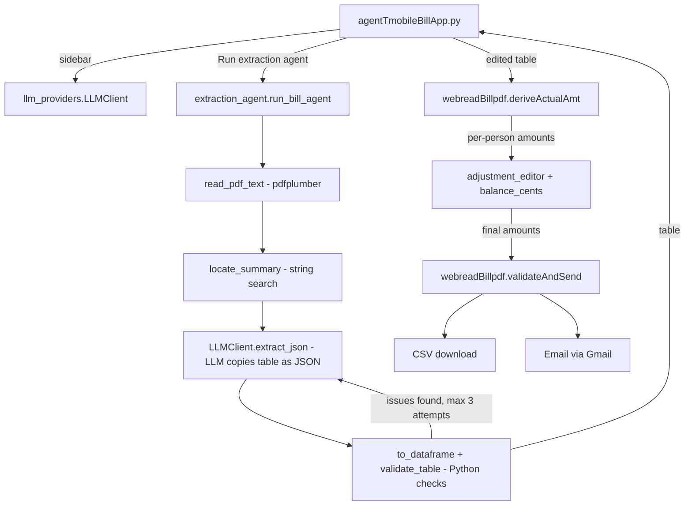

# Agent T-Mobile Bill Analyzer

A Streamlit web app that splits a T-Mobile bill per person. An LLM agent reads the
**"THIS BILL SUMMARY"** table from the bill PDF (no regex parsing), Python checks the
numbers, and the per-line math from `webreadBillpdf.py` does the split.
The CSV download and email work the same way as in the original app.

Nothing personal is in the code: names, phone lines, split rules and email recipients
come from a **billing config** (see [Onboarding](#onboarding-billing-config)), so anyone
can use the app for their own family plan.

```bash
streamlit run agentTmobileBillApp.py
```

---

## Project structure

```
agentTmobileBillApp/
├── agentTmobileBillApp.py            # Streamlit app (entry point / "Main file path" on Streamlit Cloud)
├── tmobile_bill_agent/               # Agent package used by the app
│   ├── __init__.py
│   ├── llm_providers.py              # LLM connection: Groq / Ollama / Gemini / OpenRouter / Anthropic
│   ├── extraction_agent.py           # Agent loop: read PDF -> LLM extract -> validate -> retry
│   ├── bill_config.py                # Billing config: parse/validate/serialize (no Streamlit)
│   └── config_ui.py                  # Billing config sidebar upload (TOML/YAML) + onboarding editor
├── webreadBillpdf.py                 # Original app; per-line math, CSV and email
├── tests/test_billing.py             # Unit tests: config parsing and the per-person split
├── requirements.txt                  # Python dependencies (installed by Streamlit Cloud)
├── .streamlit/
│   └── secrets.toml.example          # Template for secrets.toml (API keys + billing config)
├── .gitignore                        # Keeps secrets, PDFs and CSVs out of git
└── README.md

Not committed (local only, ignored by .gitignore):
└── .streamlit/secrets.toml           # Your real API keys and billing config
```

| File | Role |
|---|---|
| `agentTmobileBillApp.py` | Builds the UI: sidebar LLM settings, PDF upload, editable tables, cents adjustment, CSV/email section. Shows the onboarding editor when a bill has phone numbers the billing config doesn't know. |
| `tmobile_bill_agent/llm_providers.py` | `LLMClient` gives every provider the same `extract_json(...)` call. `PROVIDERS` lists the providers; Groq is the default. |
| `tmobile_bill_agent/extraction_agent.py` | `run_bill_agent(...)` reads the PDF, locates the summary table, asks the LLM to copy it, validates it and retries with feedback. It also contains `balance_cents(...)` for auto-balancing. |
| `tmobile_bill_agent/bill_config.py` | `parse_config()` validates the billing config, fed by `parse_toml()` / `parse_yaml()` (`parse_file()` picks by extension); `to_toml()` / `to_yaml()` write it; `find_unmapped()` lists bill lines nobody owns. |
| `tmobile_bill_agent/config_ui.py` | `billing_config_sidebar()` loads the config (session > uploaded file > secrets); `onboarding_editor()` builds one from a bill. |
| `webreadBillpdf.py` | Provides `deriveActualAmt(df, config)` (per-line/per-person math) and `validateAndSend()` (CSV + email to the members' emails). |
| `.streamlit/secrets.toml` | Read by Streamlit as `st.secrets`: API keys and the `[billing]` config. |

---

## How the files are invoked



Step by step:

1. **Sidebar:** `llm_sidebar()` builds an `LLMClient` from the chosen provider, model and API key.
2. **Run extraction agent:** `run_agent()` calls `run_bill_agent(pdf, llm)`, which:
   - reads the page text with pdfplumber (`read_pdf_text`);
   - cuts out the text between `THIS BILL SUMMARY` and `DETAILED CHARGES` (`locate_summary`);
   - asks the LLM to copy the column headers and each row's amounts in printed order (`LLMClient.extract_json`);
   - lines the amounts up with the columns and converts them to numbers (`to_dataframe`);
   - checks the table (`validate_table`). If anything fails, the exact errors go back to the LLM and it tries again, up to the "Max agent attempts" setting.
3. **Per-line math:** the checked table goes through `to_derive_frame()` and then into `deriveActualAmt(df, billing_config)`, the same function the original app uses. If the bill has a phone number the config doesn't know, the onboarding editor is shown first.
4. **Adjustment:** `adjustment_editor()` shows each person's amount with an editable **Final amount** column; `balance_cents()` powers **Auto-balance cents**.
5. **Output:** the final amounts go to `validateAndSend()`, the same function the original app uses for the CSV download and email.

---

## Run locally

```bash
cd agentTmobileBillApp
pip install -r requirements.txt
cp .streamlit/secrets.toml.example .streamlit/secrets.toml   # then paste your real GROQ_API_KEY
streamlit run agentTmobileBillApp.py
python -m unittest discover tests                            # optional: run the tests
```

The `[billing]` block in the template is sample data. Replace it with your own, or delete it
and let the app's onboarding build it (next section).

---

## Onboarding (billing config)

The billing config says who pays for each phone line, how each line's plan cost is split,
and who receives the bill email:

```toml
[billing]
owner_name = "Your Name"     # email signature
due_day = 6                  # bill due day of month

[[billing.members]]
name = "Alice"
emails = ["alice@example.com"]
lines = [
  { phone = "(555) 000-1111", label = "Alice", split = "shared" },
  { phone = "(555) 000-4444", label = "Alice Kid Watch", split = "own" },
]
```

- `split = "shared"` (default): the line's plan cost is pooled with the account-level charge
  and the pool is split equally across all shared lines.
- `split = "own"`: the line pays exactly its own charges (plan shown as Equipment), e.g. a kids watch.
- Phone numbers can be written in any format; only the 10 digits are compared.
- Every member's `emails` receive the bill email.

The same config as YAML (for uploading only):

```yaml
billing:
  owner_name: "Your Name"
  due_day: 6
  members:
    - name: "Alice"
      emails: ["alice@example.com"]
      lines:
        - {phone: "(555) 000-1111", label: "Alice", split: "shared"}
        - {phone: "(555) 000-4444", label: "Alice Kid Watch", split: "own"}
```

Put text values in quotes in YAML: a bare `no`, `yes`, `on` or `off` is read as true/false
(the app reports this instead of guessing).

**Where the app looks for it** (first one found wins):

1. A config built with **Use this config now** in the onboarding editor (this browser session only).
2. A `.toml`, `.yaml` or `.yml` file uploaded in the sidebar under **Billing config** (this session only).
3. `[billing]` in `.streamlit/secrets.toml` (local) or App → Settings → Secrets (Streamlit Cloud).

**First-time setup for a new user:** upload a bill and run the extraction. Because no config
exists yet, the app lists every phone number on the bill. Fill in *Label*, *Person* and
*Split*, then the email addresses, owner name and due day, and click:

- **Download config (TOML)** to save `billing_config.toml`. Paste it into your `secrets.toml`
  (or the Streamlit Cloud Secrets box) for permanent use, or upload it in the sidebar next time.
- **Download config (YAML)** to save `billing_config.yaml`, which is easier to edit by hand.
  Upload it in the sidebar next time. (`secrets.toml` itself must stay TOML.)
- **Use this config now** to continue right away.

If a later bill has a new line, the same editor appears with the known lines filled in.
To change the config at any time, use **Edit billing config** above the per-person split.

Uploaded or session configs are never written to disk on the server, so several families
can share one deployment, each bringing their own config file.

Get a free Groq API key at https://console.groq.com/keys.

**Ollama (local, no key):** only works when you run the app on your own machine, not on Streamlit Cloud.

---

## Deploy to Streamlit Community Cloud

> ⚠️ The code no longer contains names or phone numbers, but **earlier git commits do**.
> Keep the repo private unless you rewrite the history (e.g. with `git filter-repo`).

1. **Push to GitHub** (private repo):
   ```bash
   cd agentTmobileBillApp
   git init && git add . && git status     # confirm secrets.toml and *.pdf are NOT listed
   git commit -m "Agent T-Mobile bill analyzer"
   git branch -M main
   git remote add origin https://github.com/<your-user>/agentTmobileBillApp.git
   git push -u origin main
   ```
2. Go to https://share.streamlit.io, sign in with GitHub, and click **Create app**:
   - **Repository:** `<your-user>/agentTmobileBillApp`
   - **Branch:** `main`
   - **Main file path:** `agentTmobileBillApp.py`
   - **Advanced settings → Python version:** 3.12
3. **Advanced settings → Secrets:** paste the contents of your local `.streamlit/secrets.toml`, using
   `.streamlit/secrets.toml.example` as the template. Include the real `GROQ_API_KEY`
   and your `[billing]` block.
4. Click **Deploy**. Streamlit Cloud installs `requirements.txt` and starts the app.
5. **Restrict who can open it:** go to App → **Settings → Sharing** and allow only invited
   viewers. The app can send email and uses your Groq key, so don't leave it public.

**Updating:** `git push` to `main` redeploys the app automatically. To change keys or the billing
config, edit them in App → Settings → Secrets.

---

## Using the app: inputs

| Step | What you provide | Where |
|---|---|---|
| 1 | LLM provider and model. The default is **Groq / `openai/gpt-oss-120b`**; the key fills in from `secrets.toml`. Click **Test connection** to check it. | Sidebar |
| 2 | The T-Mobile **summary bill PDF**, e.g. `SummaryBillAug2025.pdf`. | "Choose a PDF file" |
| 3 | Click **Run extraction agent**. | Main page |
| 4 | *(Optional)* Fix any misread cell in the extracted table, or the bill total. | Section 1 |
| 5 | *(Optional)* Adjust per-person cents: edit **Final amount**, or click **Auto-balance cents**. Use **Reset adjustments** to undo. | Section 3 |
| 6 | Type `Y` in **Save CSV? (Y/N)** and/or **Send out email? (Y/N)**. | Section 4 |
| 7 | For email: your Gmail address and a Gmail **app password**. | Sidebar (appears after you type `Y`) |

---

## Expected outputs

**Agent log** (status panel):
```
Read 6 page(s) from the PDF.
Located 'THIS BILL SUMMARY' section.
Attempt 1: asking Groq (free tier) / openai/gpt-oss-120b to extract the table...
Attempt 1: all validation checks passed ✓
```

**1. Extracted bill summary:** an editable table with these columns:
`Phone Number | Line Type | Plans | Equipment | Services | One-time | Total`.
Below it you'll see either a green "checks passed" message or a warning that lists the problems.

**2–3. Per-person split:** for example, from `SummaryBillAug2025.pdf`:

| Person | Calculated amount | Final amount |
|---|---|---|
| Person A | 106.21 | 106.20 |
| Person B | 45.60 | 45.59 |
| Person C | 45.60 | 45.60 |
| Person D | 22.80 | 22.80 |
| Person E | 45.60 | 45.60 |

```
Total Individual Amount : 265.79
Total Bill Stmt Amount : 265.79
```
*(Final amounts shown after **Auto-balance cents**. Before balancing, the total is 265.81, which is +0.02 from rounding.)*

**4. CSV / Email:**
- **CSV:** a preview plus a **Download CSV** button that saves `data.csv` with the columns `Person, Individual amount`.
- **Email:** subject `Pay T-Mobile bill for <Mon> <Year>`, with the per-person table in the body, sent to every member's `emails` in the billing config.
  It is only sent when the per-person total is within **$0.05** of the bill total. Otherwise the app shows "Difference exceeds acceptable limits" and you can adjust the cents in section 3.

---

## Validation checks the agent runs

- There is exactly one `Account` row, and the phone numbers are unique and well formed.
- Each row's Plans + Equipment + Services + One-time equals its Total.
- All the row totals add up to the bill's statement total.
- The number of phone lines matches the number of lines in the PDF, and every phone number appears in the PDF text.

The "One-time charges" column (seen in the Sep 2025 bill) is folded into Services before
the per-line math, so those charges stay with the line that incurred them.

---

## Troubleshooting

| Message | Fix |
|---|---|
| `needs an API key` | Add the key to `.streamlit/secrets.toml` (local) or App → Settings → Secrets (cloud), or paste it in the sidebar. |
| `model '...' not found. Available models: ...` | The provider retired the model. Type one of the listed models in the sidebar's **Model** box. |
| `Cannot reach Ollama` | Run `ollama serve` (local only; Ollama is not available on Streamlit Cloud), or switch back to Groq. |
| `No email recipients` | Add `emails = [...]` to the members in the billing config. |
| `[billing] in secrets.toml has problems` | The message lists each problem (duplicate phone, bad split, missing owner_name, ...). Fix it in secrets.toml, or upload a corrected file. |
| `phone numbers are not in the billing config` | A new line is on the bill. Assign it in the editor that appears, then download the updated config. |
| Validation warnings after 3 attempts | Fix the cells in section 1 by hand. The split recalculates immediately. |
| `Difference ... exceeds acceptable limits` | Use **Auto-balance cents** or edit **Final amount** in section 3. |
